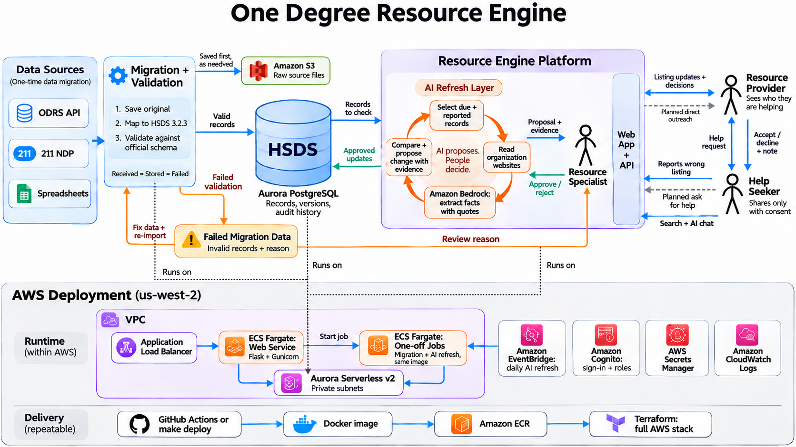

# One Degree Resource Engine

**Keeps community resource listings accurate, with AI that proposes updates and people who approve them.**

   

[Architecture](#architecture) · [Quick start](#quick-start) · [Real data](#real-data) · [Deploy](#deploy-to-aws) · [Status](#project-status) · [Scaling](#scaling) · [Docs](#documentation)

## Why this exists

[One Degree](https://www.1degree.org) helps low-income families find free and low-cost services. Its listings start going out of date the day they are published, and staff and volunteers check them by hand.

The Resource Engine moves legacy data into one open standard, checks records against organization websites, and gives reviewers a short list of proposed fixes with the evidence attached.

| Who | What they can do |
|---|---|
| **Resource specialists** | Review evidence, approve or reject changes, see why migration data failed, and run imports and AI checks (the app's admin role) |
| **Resource providers** | Propose updates to their listings, see who they are helping, and respond to requests from people who consent to share |
| **Help seekers** | Ask questions, search for services, report wrong listings, and choose what to share when requesting help |

## Architecture



The diagram shows the target design; dashed lines are planned. Today, the ODRS data API is connected and imports directly in local runs, and 211 NDP sample files and JSON upload also work. Spreadsheets need an adapter.

### Data migration

Source data moves into HSDS once. Migration runs as a one-off job.

1. Save the source data to S3 exactly as received.
2. Map it to HSDS and validate it against the official 3.2.3 schemas.
3. Store valid objects in Aurora. Hold invalid objects and their dependents as failed migration data, with a reason.
4. A resource specialist reviews the reason. The corrected data then goes through the same import and validation.

Every run must balance: received = stored + failed. Each source record is written in one transaction. On re-import, IDs stay stable, source-only changes apply, and clashes with human edits go to a specialist.

### AI refresh

AI proposes and people decide. The loop runs as a one-off job, started daily by EventBridge or on demand by a specialist.

1. Select records that are due or were reported by users.
2. Read the organization's website, using sample pages or live sites.
3. Extract facts with Amazon Bedrock, keeping only those whose quote appears on the page.
4. Compare the facts with the record and propose a change with the evidence.
5. A resource specialist approves or rejects it. AI cannot publish changes, and applied changes are recorded in the audit history.

### People

| Connection | What happens |
|---|---|
| **Provider ↔ specialist** | Providers propose listing updates, and specialists decide |
| **Seeker → specialist** | Seekers report wrong listings, which puts them into the next AI refresh and flags them for review |
| **Seeker ↔ provider** | Seekers send help requests, shared only with consent. Providers see who they are helping and accept or decline with a note |

Search and AI chat go through the same web app and API. Planned: direct outreach from specialists to providers, and seekers asking specialists for help.

### AWS deployment

| Diagram part | Runs on |
|---|---|
| Migration and AI refresh | ECS Fargate one-off jobs, using the web app's container image |
| HSDS records | Aurora PostgreSQL Serverless v2 in private subnets |
| Resource Engine Platform | ECS Fargate web service (Flask and Gunicorn) behind an Application Load Balancer |

Cognito handles sign-in and roles, Secrets Manager holds secrets, and CloudWatch collects logs. GitHub Actions or `make deploy` builds the Docker image, pushes it to ECR, and applies the full stack with Terraform.

### Technology

| Layer | Technology |
|---|---|
| Frontend | Vanilla JavaScript, HTML, and CSS, with no build step |
| Backend | Python 3.12, Flask, Gunicorn |
| Database | Aurora PostgreSQL Serverless v2 (SQLite locally) |
| File storage | Amazon S3 (local disk locally) |
| AI | Amazon Bedrock (mock/rules locally) |
| Search | In-process BM25; OpenSearch is optional and needs repair before use |
| Data standard | Open Referral HSDS 3.2.3 |
| Hosting | ECS Fargate, Application Load Balancer, ECR |
| Identity and secrets | Cognito (local accounts locally), Secrets Manager, hashed API keys |
| Operations | CloudWatch Logs, EventBridge Scheduler |
| Delivery | Docker, Terraform, GitHub Actions, uv |

Backends are selected in `app/container.py`.

## Quick start

You need **Python 3.12+**, **uv**, and **Make**. No AWS account or model key is required.

```bash
uv sync --frozen
make demo
```

Open **http://127.0.0.1:8000** and sign in:

| Role | Email | Password |
|---|---|---|
| Resource specialist (admin) | `admin@demo.org` | `demo-admin-1` |
| Resource provider | `provider1@demo.org` | `demo-provider-1` |
| Help seeker | `ana@demo.org` | `demo-seeker-1` |

The demo uses synthetic data and mock maintenance, and stores its data in `var/demo`. See the [local run guide](docs/local-run.md) for a guided tour.

With Docker:

```bash
docker compose up --build                      # SQLite: http://localhost:8000
docker compose --profile pg up --build app-pg  # PostgreSQL 16: http://localhost:8001
```

## Real data

**HSDS is the exchange format, not a statement about where a record came from.** The ODRS data API is connected and verified locally. The AWS demo still uses synthetic data.

| Evidence | Result |
|---|---|
| ODRS API size | 24,129 opportunities across 966 pages of 25 |
| Largest real import | 50 records into an isolated local database: 50 stored, 0 quarantined, 0 schema errors, stable on repeat |
| Real websites | Two model calls, which show integration rather than accuracy |
| Full 24,129-record import | Not run yet |

To import from the API locally, put an authorized `ODRS_API_KEY=...` in the ignored `.env` file and run:

```bash
uv run --frozen python -m app.jobs.run import
```

This imports the sources in `config/sources.json` into the local database, with ODRS capped at one page of 25 records. Check the received, stored, and quarantined counts. An empty response does not count as a successful import.

**To connect a deployment to the API:**

1. Store the key in Secrets Manager and map it with `source_token_secret_arns = { ODRS_API_KEY = "arn:..." }`.
2. Set `sources_config = "/srv/config/sources.json"`, `allow_sample_sources = false`, and `odrs_api_url`.
3. Give every enabled source an HTTPS location. The NDP source points at local sample files, so set `ndp_api_url` or disable it.
4. Raise `max_pages` in `config/sources.json` when ready. It is capped at one page of 25 records, and the file is built into the image.
5. Validate in an isolated environment before replacing the synthetic records.

Live website checks also need `website_backend = "live"` and the fetch hardening in [known limitations](docs/known-limitations.md). A source with a different response shape needs its own adapter; storage, the API, and the frontend stay the same.

## Deploy to AWS

You need Git, AWS CLI, Docker with Buildx, Terraform **1.10+**, Make, Python, and uv, plus an AWS identity that can provision the stack.

**1. Set credentials.** For the workshop account, get temporary credentials from the event dashboard ([details](docs/workshop-aws.md)). For another account, use its authorized profile.

```bash
uv sync --frozen
uv run --frozen python scripts/configure_workshop_profile.py
export AWS_PROFILE=workshop AWS_REGION=us-west-2
aws sts get-caller-identity
```

**2. Configure.** Run `cp -n infra/terraform/workshop.tfvars.example infra/terraform/workshop.tfvars`, then edit it:

```hcl
region            = "us-west-2"
workshop_mode     = true    # allows database deletion without a final snapshot
schedules_enabled = false   # enable after manual import and maintenance succeed
llm_backend       = "bedrock"
bedrock_model_id  = "REPLACE_WITH_ACCOUNT_ENABLED_MODEL_OR_INFERENCE_PROFILE"
website_backend   = "sample"

# Synthetic demo:
sources_config       = "/srv/config/sources.demo.json"
allow_sample_sources = true
maintenance_schedule_enabled = true

# Required before public login:
# certificate_arn = "arn:aws:acm:us-west-2:ACCOUNT_ID:certificate/CERTIFICATE_ID"
```

**3. Build and apply.** Commit first, so the image tag identifies the build. The script asks for confirmation before bootstrapping and again before applying, then waits for ECS and checks `/api/health`.

```bash
make deploy
```

**4. Load data.** Infrastructure starts empty. Import from the admin console, or start a one-off ECS task with the command `python -m app.jobs.run import`. For the demo logins and data:

```bash
APP_URL=https://your-domain.example make demo-accounts
```

Then run a one-off task with `python -m app.jobs.run seed-demo --limit 5`. The limit bounds its real-model calls.

**5. Update.** Commit, run `make deploy` with the same account, region, and backend, and repeat the checks below. A Git push or a healthy old task does not confirm that the new image is running.

GitHub Actions offers a separate OIDC path, and it does not read your local `tfvars`. See [deployment details](docs/deployment.md).

### Verify a deployment

`/api/health` should show `status=ok`, `database=postgres`, `auth=cognito`, `blob=s3`, and the official validator. It reports configuration only, so also check behavior:

- [ ] **Access:** log in with all three roles and check provider boundaries.
- [ ] **Import:** import a small dataset twice. Check counts, quarantine reasons, and raw S3 data.
- [ ] **AI:** run limited maintenance, then approve an evidence-backed proposal and inspect its history. Chat can fall back to a preset answer, so a reply alone is not proof.
- [ ] **Jobs:** verify a job's ID, ECS task ARN, and final status, and check the `/ecs/resource-engine` logs.
- [ ] **Documents and API:** approve a document, check its cited answer, and create and revoke an API key.
- [ ] **Schedules:** confirm an actual run. Cron expressions use UTC.

## Project status

This is a workshop demo using synthetic data, not a production service.

**Live AWS state, checked 2026-11-05 (America/Los_Angeles)**

| Area | State |
|---|---|
| Compute | `us-west-2`, one ECS task (0.5 vCPU, 1 GB), task definition `resource-engine:3`, image `46003ef` |
| Database | Aurora Serverless v2, one instance, 0.5–4 ACU |
| Health | `ok` with PostgreSQL, Cognito, S3, and the official validator |
| Data | 300 synthetic services through `sources.demo.json`; no ODRS or NDP feed or source key is configured |
| AI | Bedrock `us.anthropic.claude-sonnet-4-6` extracting from generated sample pages |
| Last full check | 300/300 checked: 212 verified, 28 missing information, 27 discrepancy, 20 actively bad, 13 check failed; 57 proposals pending |
| Schedules | Daily maintenance at 12:00 UTC; no scheduled imports; checks also run after imports |
| Search | In-memory |
| Transport | HTTP only; configure HTTPS before public login |

**What's next**

- **Accuracy:** thresholds come from synthetic pages and are not evidence of accuracy on real websites. Changed hours and accessibility are flagged only when the record lacks those fields.
- **Import:** shared objects keep the first version seen in a run, and later differences are only counted.
- **Before production:** fix chat-session ownership, provider request claiming, and consent withdrawal. Add HTTPS, account recovery, rate limiting, real-page evaluation, task recovery, and monitoring.
- **Planned:** spreadsheet ingestion, specialist-to-provider outreach, direct help requests to specialists, source-deletion handling, cross-source deduplication, semantic or multilingual search, and HSDS write endpoints.

See [known limitations](docs/known-limitations.md).

## Scaling

The web tier keeps its state in Aurora and S3, and jobs run as separate tasks, so each part can grow separately. This has been run at 300 services, not at the full source size.

| Part | Today | Next step |
|---|---|---|
| **Re-import** | Builds the identity lookup once per run instead of once per record | Measure a full 24,129-record import |
| **Website checks** | One record at a time on live sites, with no sharding or crash recovery | Check different hosts in parallel from a resumable work queue |
| **Search** | Each Gunicorn worker keeps its own index and rebuilds it after any record change | Repair OpenSearch filters and index rebuilds, then enable it |
| **Web capacity** | One task, set by hand, with no autoscaling | Raise `app_count`, then add ECS autoscaling |
| **Database** | One instance, up to 4 ACU, with no connection pool | Raise `db_max_acu`, add a standby instance, and add pooling or RDS Proxy |

Scheduled checks size themselves to the corpus: `ceil(services / 30 days) × 1.2`, or about 966 checks per day for 24,129 services. An unchanged page and record skip the model call.

## Development

```bash
make test
terraform -chdir=infra/terraform validate
```

The last local run had **116 tests passing, with 4 PostgreSQL tests skipped**. To include them, set `TEST_DATABASE_URL` to a disposable PostgreSQL database. CI provisions one automatically.

Keep credentials, databases, Terraform state and plans, `.tfvars`, and workshop exports out of Git.

| Path | Contents |
|---|---|
| `app/` | API, adapters, HSDS validation, services, maintenance, and job CLI |
| `frontend/` | JavaScript UI for all three roles and the API console |
| `schemas/hsds/3.2.3/` | Pinned official schemas |
| `config/`, `content/` | Source definitions and policy content |
| `tools/sample_data_generator/` | Synthetic data, website fixtures, and demo seeding |
| `tests/`, `reports/` | Regression, maintenance evaluation, and API verification |
| `scripts/` | Deployment, demo accounts, credentials, and verification tools |
| `infra/`, `.github/workflows/` | AWS stack, state and OIDC bootstrap, and CI/CD |
| `.kiro/` | Steering and feature requirements, design, and tasks |

## Documentation

| Topic | Documents |
|---|---|
| **Product** | [Business requirements](docs/BRD.md) · [Decisions](docs/decisions.md) · [Known limitations](docs/known-limitations.md) |
| **Design** | [Technical specification](docs/technical-spec.md) · [Detailed design](docs/detailed-design.md) · [HSDS mapping](docs/hsds-mapping.md) |
| **Running it** | [Local run](docs/local-run.md) · [Deployment details](docs/deployment.md) · [Workshop AWS access](docs/workshop-aws.md) |
| **Quality** | [Test plan](docs/test-plan.md) · [API report](reports/API_REPORT.md) · [Kiro and prompt audit](docs/kiro-and-prompts-audit.md) |
