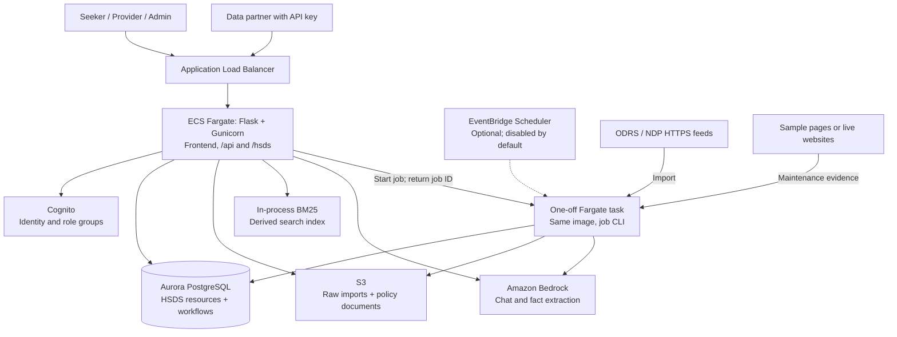

# One Degree Resource Engine

A community-resource directory for **help seekers, service providers and One Degree admins**. It imports One Degree ODRS and 211 NDP data, validates it against **Open Referral HSDS 3.2.3**, and uses supervised AI maintenance to propose corrections with evidence. Providers and AI submit changes for human approval; applied changes have an audit history.

[Architecture](#architecture) · [Local demo](#run-locally) · [AWS deployment](#deploy-to-aws) · [Verification](#verify-the-deployment) · [Documentation](#documentation)

## Deployment status

Last observed on **2026-11-04, America/Los_Angeles**:

| Area | Observed state |
|---|---|
| Hosting | AWS `us-west-2`; ECS deployment completed with one running task |
| Application health | `/api/health` returned `ok`, PostgreSQL, Cognito, S3 and the official HSDS 3.2.3 validator |
| Model configuration | Bedrock profile `us.anthropic.claude-sonnet-4-6`; actual inference needs a separate functional check |
| Data configuration | Sample website backend; ODRS/NDP HTTPS endpoints not configured |
| Search and scheduling | In-memory search; no project EventBridge schedules present |
| Public transport | ALB had an HTTP listener only; configure HTTPS before public login |
| Observed image | `49651aa-dirty-20261104153034`, task definition `resource-engine:1` |
| Repository checks | 86 Python tests passed; 4 PostgreSQL integration tests skipped without `TEST_DATABASE_URL`. Terraform validation passed |

This is a workshop demo deployment. The observed image predates later repository changes: **pushing a branch does not update the running ECS image**. Deploy again for a new source version. Health reports backend configuration; the functional checks below establish whether login, imports, storage and model calls work.

## Architecture

The frontend is a vanilla JavaScript single-page app served by Flask. Gunicorn runs the web process. The same container image runs imports, maintenance and indexing as one-off ECS Fargate tasks.



| Layer | Implementation |
|---|---|
| UI and app API | `frontend/`, `app/web/`; JWT authentication and server-side role/organization checks |
| Resource exchange | `/hsds/*`; read-only HSDS endpoints with hashed API keys and optional source scope |
| Import and validation | `app/adapters/`, `app/hsds/`; official schemas, deterministic IDs, source snapshots and dependency-aware quarantine |
| Storage | `app/db.py`, `app/services/`; HSDS documents stored as JSON text, with relational workflow, account, request, job and audit tables |
| Search and documents | BM25 over resources and approved public document chunks; optional OpenSearch needs further validation |
| Maintenance | `app/maintenance/` and the service bridge; grounded extraction, fact comparison, review flags and proposed patches |
| Delivery | `infra/terraform/`, `infra/bootstrap/`, `.github/workflows/`; AWS stack, state/OIDC bootstrap and CI/CD |

**Import:** preserve raw bytes → map records → validate objects → quarantine invalid objects and dependent children → atomically store the accepted graph. Re-import preserves stable IDs. Three-way reconciliation applies source-only changes and opens conflicts when source and human changes differ. Source-record and mapped-object counts balance separately.

**Maintenance:** select due or reported services → read sample/live evidence → skip repeat model review when the page and record are unchanged → extract supported facts → create proposals → admin approves or rejects. AI does not directly publish changes. Batch size derives from service count and the recheck window; task sharding is not implemented.

**Seeker/provider:** anonymous questions → sign-in/profile for matching → explicit sharing consent and request confirmation → provider response. Providers propose listing edits; admins review them. Real seeker data remains outside the workshop scope while privacy and authorization work is completed.

Backends are selected in `app/container.py`:

| Concern | Local default | AWS deployment |
|---|---|---|
| Database | SQLite | Aurora PostgreSQL Serverless v2 in private subnets |
| Authentication | Local accounts | Cognito |
| Raw payloads/documents | Local disk | S3 |
| Language model | Mock/rules | Bedrock, or explicit mock mode |
| Website evidence | Generated sample pages | Configurable `sample` or `live` |
| Search | In-process BM25 | BM25 by default; optional OpenSearch |
| Jobs | Local threads / CLI | One-off Fargate tasks; optional EventBridge schedules |

## Run locally

Requires **Python 3.12+**, **uv** and **Make**. Run commands from this repository's root.

```bash
uv sync --frozen
make demo
```

Open **http://127.0.0.1:8000**. The demo imports synthetic data, seeds users, requests and documents, and runs mock maintenance. Existing databases are preserved. No AWS account or model key is needed.

| Role | Email | Demo password |
|---|---|---|
| Admin | `admin@demo.org` | `demo-admin-1` |
| Provider | `provider1@demo.org` | `demo-provider-1` |
| Help seeker | `ana@demo.org` | `demo-seeker-1` |

With Docker and Compose:

```bash
docker compose up --build                     # SQLite: http://localhost:8000
docker compose --profile pg up --build app-pg  # PostgreSQL 16: http://localhost:8001
```

See [Local run](docs/local-run.md) for a guided tour and additional accounts.

## Deploy to AWS

### 1. Prepare tools and credentials

Install Git, AWS CLI, Docker with Buildx, Terraform **1.10+**, Make, Python and uv. Start the Docker engine. The AWS identity needs permission to provision the stack and pass its ECS roles.

For the workshop account, obtain temporary CLI credentials from the event dashboard, then run:

```bash
uv sync --frozen
uv run --frozen python scripts/configure_workshop_profile.py
export AWS_PROFILE=workshop
export AWS_REGION=us-west-2
aws sts get-caller-identity
```

For another account, use its authorized profile instead. The helper stores workshop credentials under your user AWS configuration, outside the repository. See [Workshop access and account lifetime](docs/workshop-aws.md).

### 2. Configure the environment

Copy the example once if the ignored local file does not already exist:

```bash
cp -n infra/terraform/workshop.tfvars.example infra/terraform/workshop.tfvars
```

Edit `infra/terraform/workshop.tfvars`:

```hcl
region            = "us-west-2"
workshop_mode     = true
schedules_enabled = false
db_engine_version = "16.15"

llm_backend      = "bedrock"
bedrock_model_id = "REPLACE_WITH_ACCOUNT_ENABLED_MODEL_OR_INFERENCE_PROFILE"
website_backend  = "sample"

# Authorized live feeds or hosted HTTPS synthetic feeds; replace both examples.
odrs_api_url = "https://your-odrs-feed.example/resources"
ndp_api_url  = "https://your-ndp-feed.example/resources"

# Issued ACM certificate for your domain; required before public login.
# certificate_arn = "arn:aws:acm:us-west-2:ACCOUNT_ID:certificate/CERTIFICATE_ID"

# Existing Secrets Manager ARNs, never bearer token values.
# source_token_secret_arns = { ODRS_TOKEN = "arn:aws:secretsmanager:..." }
```

Replace example endpoints and model placeholders before deployment. Confirm the database engine and model are available in the account. For a demo without model calls, set `llm_backend = "mock"` and `bedrock_model_id = ""`.

- **Imports:** every enabled source in `config/sources.json` needs an HTTPS endpoint on AWS; disable sources you have not connected. Empty endpoints leave local file paths, which AWS import rejects.
- **Website mode:** `sample` reads generated website evidence; `live` fetches real sites. This does not configure ODRS/NDP feeds.
- **Scheduling:** keep `schedules_enabled = false` until manual import and maintenance succeed.
- **Account lifetime:** `workshop_mode = true` permits database deletion without a final snapshot. Use `false` for durable environments and review backup/recovery requirements.
- **HTTPS:** `certificate_arn` enables HTTPS and HTTP redirect. Manage the domain and its ALB DNS mapping separately.

### 3. Build and apply

Use committed source so the image tag identifies the build:

```bash
git status --short
make deploy
```

The script checks the AWS identity and asks for confirmation twice:

1. Create/reuse the private, versioned state bucket and ECR repository, then build/push a `linux/amd64` image tagged with the short commit SHA.
2. Show the Terraform plan and ask before applying the rest of the stack.

It then waits for ECS to stabilize and checks `/api/health`. The first confirmation already permits state-bucket/ECR changes. State uses bucket `resource-engine-tfstate-<account>-<region>` and key `resource-engine.tfstate`; reuse that backend for updates.

`TFVARS=/absolute/path/to/environment.tfvars make deploy` selects another settings file. An intentional uncommitted build can use `DEPLOY_ALLOW_DIRTY=1 make deploy`; its timestamped tag requires a separate source record.

Retrieve resource identifiers with:

```bash
terraform -chdir=infra/terraform output
```

### 4. Initialize data and accounts

Creating infrastructure does not populate data. Import through the admin console after creating an administrator, or use **ECS → resource-engine cluster → Tasks → Run new task**. Select the deployed task definition, the service's subnets/security group and an enabled public IP. Override the `app` container command:

```text
python -m app.jobs.run import
```

The task uses deployed source endpoints and secrets. After importing the synthetic `Bay Area Diaper Bank` organization, run this locally to create/reset the three login-page demo accounts:

```bash
APP_URL=https://your-domain.example make demo-accounts
```

If that organization is missing, the script creates admin/seeker accounts, then reports the missing provider association. For another dataset, create a private admin and provider logins linked to the actual organizations; see [Deployment details](docs/deployment.md#end-to-end-validation).

For a synthetic environment, run another one-off ECS task to seed demo profiles, requests, reports and policy documents:

```text
python -m app.jobs.run seed-demo --limit 5
```

Seeding imports sources if the service store is empty, creates Cognito demo logins without invitation emails, and preserves existing application data on repeat runs. The limit bounds this seed's real-model maintenance pass. Outside local mode, create API keys in the admin console so their values do not appear in seed logs.

For generated-file demo sources, explicitly add **`ALLOW_SAMPLE_SOURCES=true` to the one-off task's container environment overrides**. The current Terraform stack exposes no variable for this; a local shell export does not forward it to ECS. This one-off override does not enable later admin/scheduled imports, which still need configured HTTPS feeds or a corresponding task-definition change.

Demo credentials are public and intended for synthetic data. Use the application's HTTPS URL for account operations; the account script otherwise defaults to the HTTP ALB address.

### 5. Update an existing deployment

Commit the intended changes, refresh temporary credentials if needed, and run `make deploy` using the same account, region and backend. Review the plan and repeat the functional checks. A Git push or an existing healthy task does not confirm that the new image is running.

### GitHub Actions deployment

The [deploy workflow](.github/workflows/deploy.yml) provides a separate OIDC path. Follow [OIDC/state bootstrap](docs/deployment.md#one-time-oidcstate-bootstrap), then configure:

| GitHub setting | Purpose |
|---|---|
| Environment `production` | Deployment environment and optional reviewer/branch rules |
| Secret `AWS_DEPLOY_ROLE_ARN` | Authorized OIDC deploy role |
| Variables `TF_STATE_BUCKET`, `AWS_REGION` | Existing state backend and region |
| Variables `BEDROCK_MODEL_ID`, `ODRS_API_URL`, `NDP_API_URL` | Model and HTTPS sources |
| Optional `WORKSHOP_MODE`, `SCHEDULES_ENABLED`, `SOURCE_TOKEN_SECRET_ARNS` variables | Lifetime, scheduling and source-token ARN mapping |
| Variable `AWS_DEPLOY_ENABLED=true` | Automatic deployment on pushes to `main` |

Manual `workflow_dispatch` also runs deployment after its test job. Pushes to `deploy` do not automatically deploy. The workflow does not read your ignored local `workshop.tfvars`; add workflow configuration for overrides such as `website_backend` and `certificate_arn` before switching delivery paths. Reuse the stack's state bucket/key. Keep workshop temporary credentials out of GitHub secrets.

## Verify the deployment

Use the application's configured URL:

```bash
curl --fail --silent --show-error https://your-domain.example/api/health
```

Expected composition: `status=ok`, `database=postgres`, `auth=cognito`, `blob=s3`, and the official HSDS 3.2.3 validator. Then verify actual behavior:

1. Log in as admin, provider and seeker; check provider organization associations and access boundaries.
2. Import a small dataset twice. Check idempotence, source/object counts, partial imports, quarantine reasons and raw S3 readback.
3. Run limited maintenance. Confirm a real Bedrock response and an evidence-backed pending proposal, then approve it and inspect version/history. Chat can fall back to a preset answer on model errors, so a reply alone is insufficient evidence.
4. Start an admin job and verify job ID, ECS task ARN and final status. Inspect `/ecs/resource-engine` CloudWatch logs for failures.
5. Upload/approve a document, check its cited answer, create/revoke an HSDS API key, and confirm database data survives task replacement.
6. Enable schedules only after these checks and confirm an actual execution. Cron expressions use UTC.

## Development checks and limits

```bash
make test
terraform -chdir=infra/terraform validate
```

For a fresh validation-only checkout, first run `terraform -chdir=infra/terraform init -backend=false`; keep it separate from a checkout configured for deployment. Set `TEST_DATABASE_URL` to a **disposable local PostgreSQL database** to include the four integration tests. CI provisions PostgreSQL automatically. Synthetic maintenance thresholds do not establish accuracy on real websites.

Before production, address chat-session ownership, provider request claiming and consent withdrawal, plus HTTPS, account recovery, rate limiting, real-page evaluation, task recovery and monitoring. Spreadsheet ingestion, source-deletion handling, cross-source deduplication, semantic/multilingual search and HSDS write endpoints are not implemented. OpenSearch filters and shared-index rebuild behavior need repair before enabling it. See [Known limitations](docs/known-limitations.md).

Credentials, databases, Terraform state/plans, `.tfvars` and workshop exports stay outside Git. Preserve required data and deployment evidence outside an expiring account before cleanup.

## Repository map

| Path | Contents |
|---|---|
| `app/` | API, adapters, HSDS validation, services, maintenance and job CLI |
| `frontend/` | Three-persona JavaScript UI served by Flask; no build step |
| `schemas/hsds/3.2.3/` | Pinned official schemas |
| `config/`, `content/` | Source definitions and about/policy content |
| `tools/sample_data_generator/` | Synthetic data, website fixtures and demo seeding |
| `tests/` | Regression, maintenance evaluation and PostgreSQL checks |
| `scripts/` | Deployment, demo accounts, credentials and schema tools |
| `infra/`, `.github/workflows/` | AWS stack, state/OIDC bootstrap and CI/CD |
| `.kiro/` | Steering and feature requirements/design/tasks |
| `docs/` | Product, architecture, mapping and operation details |

## Documentation

| Read this | For |
|---|---|
| [Business requirements](docs/BRD.md) | Personas, scope and acceptance goals |
| [Technical specification](docs/technical-spec.md) | Data model, algorithms and API surface |
| [Detailed design](docs/detailed-design.md) | Component and workflow diagrams |
| [HSDS mapping](docs/hsds-mapping.md) | Fields, identifiers and validation |
| [Local run](docs/local-run.md) | Demo accounts and walkthrough |
| [Deployment details](docs/deployment.md) | Manual infrastructure and OIDC setup |
| [Workshop AWS access](docs/workshop-aws.md) | Credentials and account lifetime |
| [Test plan](docs/test-plan.md) | Coverage and evaluation boundaries |
| [Decisions](docs/decisions.md) | Architecture rationale |
| [Known limitations](docs/known-limitations.md) | Deferred work and constraints |
| [Kiro/prompt audit](docs/kiro-and-prompts-audit.md) | Specification and prompt inventory |
