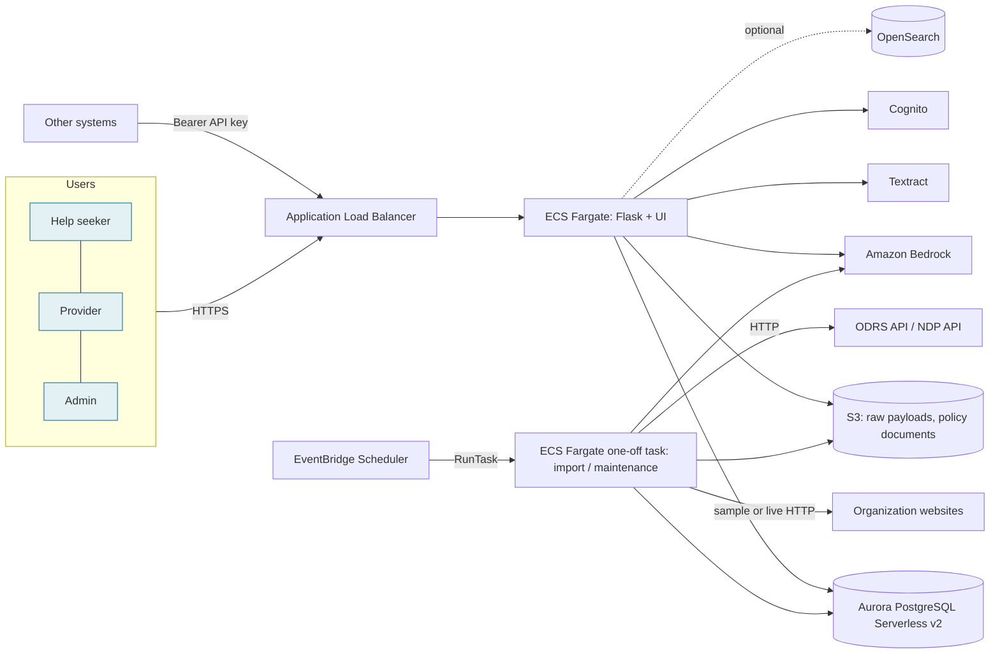
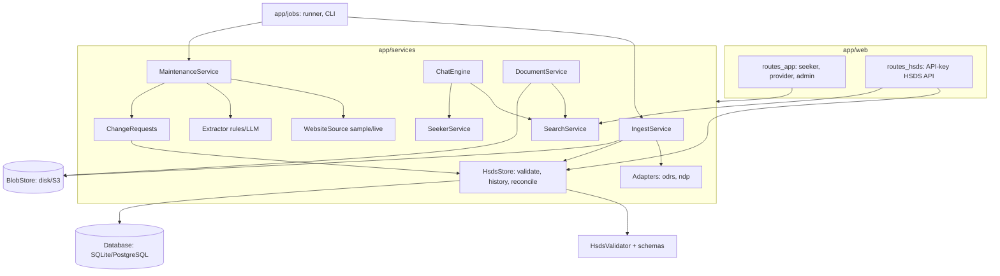
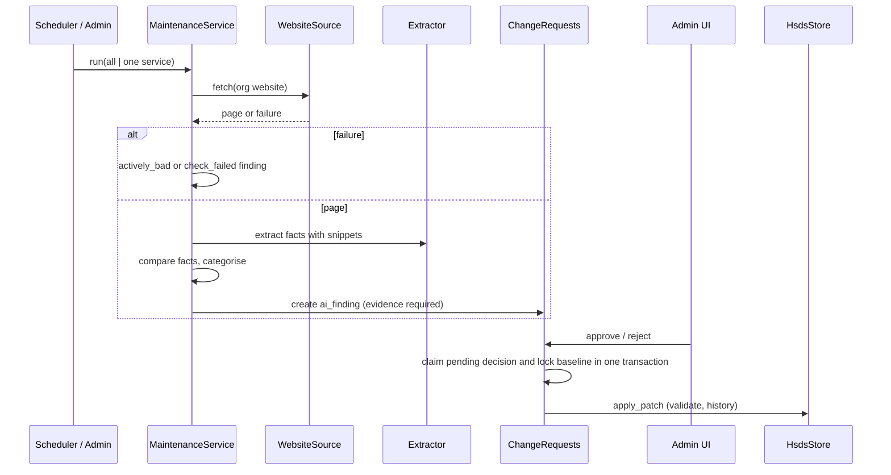
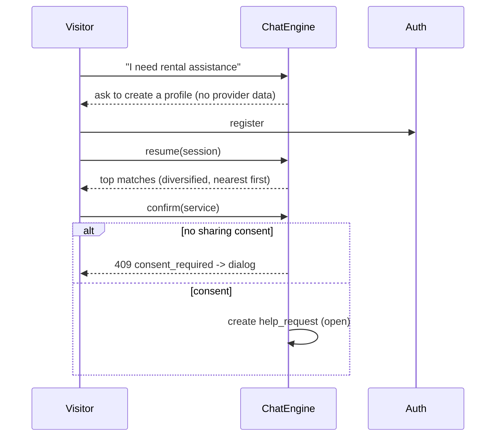

# Detailed Design

## 1. Architecture (AWS)


## 2. Components


## 3. Data flow: import and reconciliation
```mermaid
sequenceDiagram
  participant Sch as Scheduler / Admin
  participant I as IngestService
  participant A as Adapter
  participant S as HsdsStore
  participant Q as Quarantine
  Sch->>I: run(source)
  I->>A: fetch()
  A-->>I: RawBatch (bytes + records)
  I->>I: store raw bytes (as received)
  loop each source record
    I->>A: map(record)
    A-->>I: HSDS objects
    I->>S: validate all objects
    I->>I: partition valid objects; cascade invalid-parent failures
    I->>Q: preserve held objects + reasons
    I->>S: accepted graph + quarantine evidence + conflicts in one transaction
    S-->>I: created / updated / clashes / partial
  end
  I->>I: assert source-record balance and mapped-object balance separately
```

## 4. Data flow: AI maintenance and approval


## 5. Chat and request flow

Provider side: `provider_needs` lists direct requests and unassigned needs whose text matches the provider's services; contact details appear only after the provider accepts.

## 6. Deployment view
One VPC, two public subnets (ALB, Fargate tasks; no NAT) and two private subnets (Aurora). Security groups: ALB open on 80/443; app only from ALB; database only from app. Scheduled jobs use the same task definition with a command override.

`infra/bootstrap` prepares encrypted/versioned state and repository-scoped OIDC. Workshop access uses expiring event credentials and must follow event region/service restrictions. Web job starts return a durable job ID and admin UI polls status; one-off ECS tasks read stored parameters. Cognito first-password/MFA challenges complete before application login. `schema_migration` tracks workflow/compatibility upgrades; resource IDs/history survive upgrades.

## 7. Design decisions
See `docs/decisions.md`.
